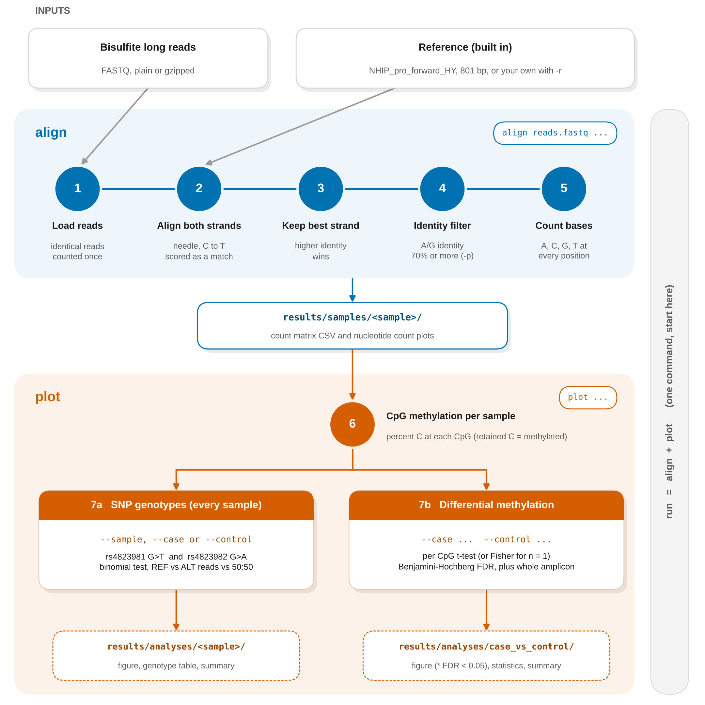
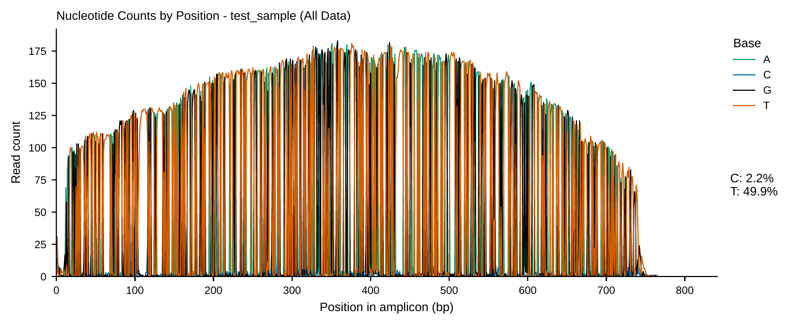
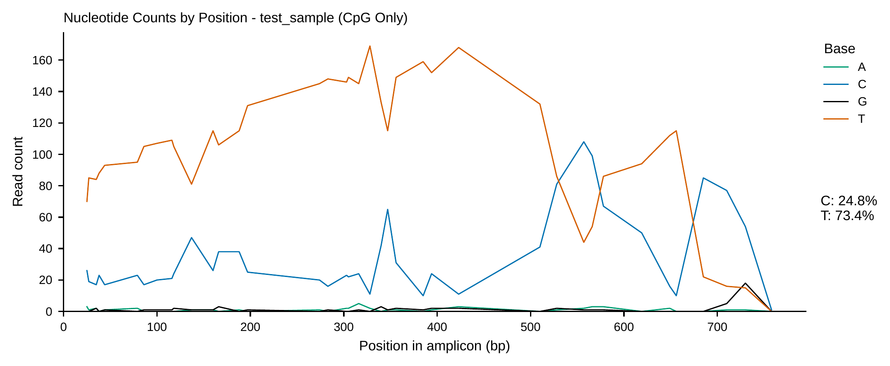
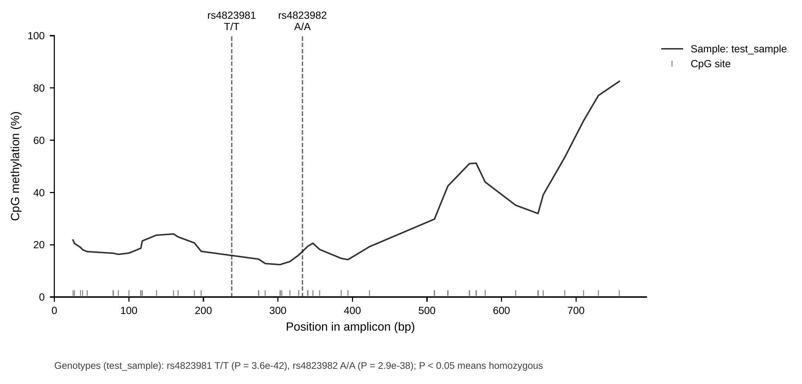
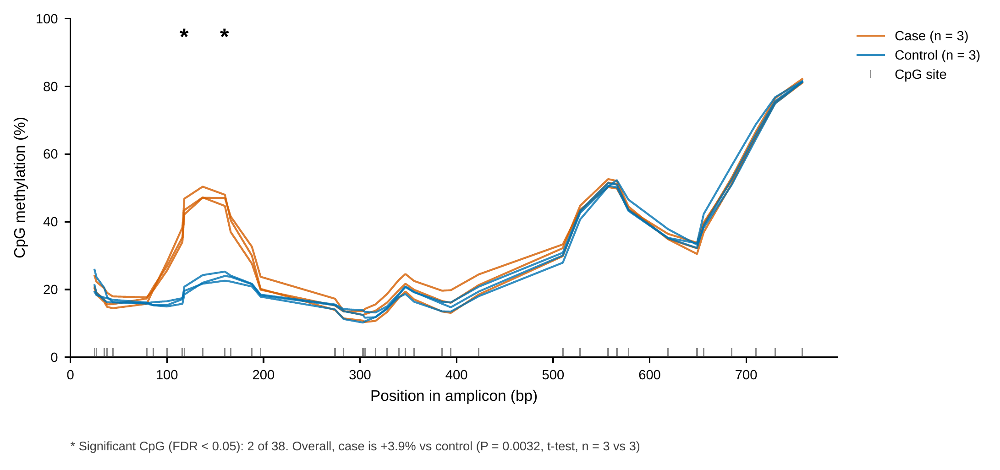

# methyl_aligner

methyl_aligner aligns bisulfite-converted long reads from an amplicon to a
reference sequence, then plots CpG methylation, genotypes two promoter SNPs,
and tests case vs control differential methylation.

Everything runs from one program, `methyl_aligner.py`, with three commands:

| Command | What it does |
|---|---|
| `align` | Aligns FASTQ reads to the reference and saves a count matrix and plots per sample |
| `plot`  | Plots CpG methylation from matrices, calls SNPs, tests case vs control |
| `run`   | Does `align` and then `plot` in one step |

Run `python3 methyl_aligner.py -h` or `python3 methyl_aligner.py <command> -h`
for help at any time.

## Pipeline ##



## Installation ##

You need EMBOSS (for `needle`) and a few Python packages. The easiest way is
conda. Install miniconda (or anaconda), clone this repository, and from the
repository folder type:

```
conda env create -f environment.yml
conda activate methyl_aligner_env
```

On an Apple silicon Mac, if conda cannot find `emboss`, create the environment
for Intel Macs instead (it runs through Rosetta):

```
CONDA_SUBDIR=osx-64 conda env create -f environment.yml
conda activate methyl_aligner_env
conda config --env --set subdir osx-64
```

Remember to `conda activate methyl_aligner_env` before each session. Only
`align` and `run` need EMBOSS; `plot` works without it.

Global alignment is not computationally efficient: it is slow and uses a lot of
memory. For this reason, the reference sequence should be a fragment just large
enough to cover the amplicon region.

## Test everything ##

After installing, run every feature on the included example data (about a
minute):

```
bash example/run_examples.sh
```

It aligns the example reads, genotypes the SNPs, runs a case vs control
comparison on simulated samples, and checks the older `percent_mC.py` command.
Everything it makes goes into `results/`, laid out as described in
[Outputs](#outputs).

## Quick start ##

Try it on the included example reads:

```
python3 methyl_aligner.py run --sample example/test_sample.fq -snp -o test_sample
```

This aligns the reads into `results/samples/test_sample/` and saves the
methylation plot, SNP genotypes and a summary into
`results/analyses/test_sample/`.

For your own experiment, compare a case and a control group:

```
python3 methyl_aligner.py run --case case1.fq case2.fq case3.fq \
    --control ctrl1.fq ctrl2.fq ctrl3.fq -o case_vs_control
```

You can also run the steps separately, which is useful when you want to re-plot
or try different groupings without realigning:

```
python3 methyl_aligner.py align case1.fq case2.fq ctrl1.fq ctrl2.fq
python3 methyl_aligner.py plot case_vs_control \
    --case results/samples/case1/case1_matrix.csv results/samples/case2/case2_matrix.csv \
    --control results/samples/ctrl1/ctrl1_matrix.csv results/samples/ctrl2/ctrl2_matrix.csv
```

Give each analysis a name (like `case_vs_control`); its outputs go into
`results/analyses/<name>/`.

FASTQ files can be plain or gzipped (`.fq`, `.fastq`, `.fq.gz`, `.fastq.gz`).

## Default reference ##

The NHIP_pro_forward_HY reference (801 bp) is built into the program, so you
only need to provide FASTQ files. To align to a different reference, pass it
with `-r`. **This is at your own risk:** the SNP positions used by `-snp` are
coordinates on NHIP_pro_forward_HY, so SNP calling does not apply to any other
reference. A warning is printed when a custom reference is used, and `-snp` is
ignored (with a warning) for any file that was not aligned to the default
reference.

## Options ##

**Alignment options** (`align` and `run`)

```
  -r <path>     custom reference FASTA [built-in NHIP_pro_forward_HY]
                  at your own risk: SNP calling does not apply
  -p <int>      percent identity minimum [70]
  -t <int>      threads [4]
  -m            bisulfite (methyl) mode [on by default]
                  C:T counts as a match, percent identity from A/G only
  --no-methyl   standard mode for unconverted DNA (plain +1/-1 scoring)
  -d <path>     create and keep a named working directory for temp files
  -w <int>      line width of the alignment files kept with -d [50]
  -f            force rewrite over named working directory
  --outdir      folder for all results [results]
```

**Plot options** (`plot` and `run`)

```
  --sample      one sample, for SNP calling (requires -snp)
  --case        case group files       } both are required for
  --control     control group files    } differential methylation
  -snp          genotype rs4823981 (G>T, pos 238) and rs4823982 (G>A, pos 333)
                  (default NHIP_pro_forward_HY reference only)
  --color       give each sample its own color instead of coloring by group
  -o <name>     analysis name for run [methylation_plot]
                  (for plot, the name is the first argument)
  --outdir      folder for all results [results]
```

An analysis name like `case_vs_control` saves into
`results/analyses/case_vs_control/`. If you give a path with a folder instead,
like `figures/fig2.pdf`, the outputs are saved there.

`plot` takes matrix CSVs made by `align`; `run` takes FASTQ files.

## SNP genotyping ##

With `-snp`, each SNP is genotyped from the REF and ALT read counts with a
binomial test against the 50:50 split expected for a heterozygote. P < 0.05
means the reads are too uneven for a heterozygote, so the site is called
homozygous for the allele with more reads; P >= 0.05 is called heterozygous.
Sites with fewer than 10 REF + ALT reads are not called. Genotypes are printed,
shown at the top of the plot, and saved to `<name>_snp_genotypes.csv`. Because genotypes can differ between samples,
use `--sample` to genotype one sample at a time.

## Differential methylation ##

With `--case` and `--control`, every CpG with at least 10 C + T reads in each
sample is tested, along with the whole amplicon (mean methylation of all tested
CpGs). Results are printed, summarized under the plot, and saved per CpG to
`<name>_differential_methylation.csv` (case %, control %, difference, P value,
Benjamini-Hochberg FDR). CpGs with FDR < 0.05 are marked with an asterisk (*).

* 2 or more files per group: Welch t-test on per-sample percent methylation.
  Samples are the unit of replication, so PCR duplicates do not inflate P values.
* 1 file in either group: Fisher's exact test on pooled C and T reads. This
  treats reads as independent and ignores sample-to-sample variation, so treat
  results as exploratory and use biological replicates for real comparisons.

## Notes ##

(1) In bisulfite (methyl) mode, the default, the scoring matrix gives +1 to C:T
matches in one direction (reference C, read T) and -1 in the other. With
`--no-methyl`, alignment uses a plain +1/-1 matrix.

(2) Percent identity is calculated by ignoring gaps. In bisulfite mode, percent
identity is calculated from only the As and Gs in the reference sequence.

(3) Identical reads are aligned once and counted once. With long reads, exact
duplicates are rare.

(4) To examine the temporary files, use the `-d` option to keep the working
directory. This contains all of the intermediate FASTA files and pairwise
alignments.

(5) Older commands still work: `python3 methyl_aligner.py [options] sample.fq`
is treated as `align`, and `python3 percent_mC.py ...` is the same as
`python3 methyl_aligner.py plot ...`.

## Outputs ##

Everything goes into one `results/` folder: one subfolder per sample from
`align`, and one per named analysis from `plot` or `run`.

```
results/
├── samples/
│   └── test_sample/
│       ├── test_sample_matrix.csv              base counts at every reference position
│       ├── test_sample_matrix_ref_c.csv        the same, CpG sites only
│       ├── test_sample_line_plot_all_data.pdf  nucleotide counts, all positions
│       ├── test_sample_line_plot_cpg_only.pdf  nucleotide counts, CpG sites only
│       └── test_sample_reference.txt           the reference sequence used
└── analyses/
    └── case_vs_control/
        ├── case_vs_control.pdf                          methylation figure
        ├── case_vs_control_differential_methylation.csv per CpG statistics (--case/--control)
        ├── case_vs_control_snp_genotypes.csv            SNP calls (-snp)
        └── case_vs_control_summary.txt                  command, inputs, parameters, results
```

The summary file records exactly how the analysis was made (command, date,
reference, alignment settings, every input file) and its key results, so you
can trace any figure back to its data.

### Nucleotide counts, all positions


### Nucleotide counts, CpG sites only


### CpG methylation with SNP genotypes (one sample)


### Differential methylation (case vs control)


Example with 3 case and 3 control samples simulated from `example/test_sample.fq`
(the matrices are in `example/matrices/`), where cases were made 30 points more
methylated at 5 CpGs near positions 116 to 166. Each line is one sample. An asterisk (*) marks CpGs with FDR < 0.05, and
the note under the plot gives the number of significant CpGs and the overall
case vs control difference with its P value. SNP calling (`-snp`) is left off
here because genotypes can differ between samples.

## Repository layout ##

```
methyl_aligner.py           the program (align, plot, run)
percent_mC.py               kept so older "percent_mC.py" commands still work
environment.yml             conda environment with every dependency
example/
├── test_sample.fq          example bisulfite long reads
├── matrices/               3 simulated case and 3 simulated control matrices
└── run_examples.sh         runs every feature on the example data
docs/images/                pipeline schematic and example figures
```
